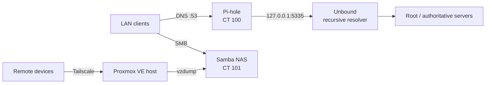

# Homelab


A home server lab built for hands-on learning toward a **Blue Team / SOC Analyst** career. Every project is documented the same way: what I built, what broke, why, and how I fixed it.

## Lab at a glance

| Item | Detail |
|---|---|
| Host | Laptop running Proxmox VE 9.2.2 (hostname `hanzallah`) |
| Router | Huawei EG8112H, `192.168.1.1` (`192.168.1.0/24`) |
| Proxmox web UI | `https://192.168.1.50:8006` |
| Pi-hole | Debian 12 LXC (CT 100), `192.168.1.60` |
| NAS | Samba LXC (CT 101), `192.168.1.61` |
| Upstream DNS | Unbound at `127.0.0.1#5335` inside the Pi-hole container |

Full address plan: [docs/network.md](docs/network.md)

## Architecture



## Projects

| # | Project | Status |
|---|---|---|
| 01 | [Proxmox + Pi-hole + Unbound](projects/01-proxmox-pihole-unbound/) | Documented |
| 02 | [Storage server / NAS (Samba)](projects/02-nas-samba/) | Documented |
| 03 | [Backups (vzdump to the NAS)](projects/03-backups/) | Documented |
| 04 | [Reverse proxy + private CA](projects/04-reverse-proxy-local-ca/) | Documented |
| 05 | [Remote access (Tailscale subnet router)](projects/05-remote-access-tailscale/) | Documented |
| 06 | Wazuh agents feeding the SOC lab | Next |
| 07 | Monitoring (Uptime Kuma, Grafana + Prometheus) | Planned |
| 08 | Jellyfin | Planned |
| 09 | Phone screen streaming (Docker) | Planned |
| 10 | Segmentation lab (OPNsense, isolated bridge) | Idea |

**More ideas:** Nextcloud, Immich, Paperless-ngx, Syncthing, second Pi-hole, Portainer, Homepage, Gitea, Home Assistant.

Security tooling (Wazuh, Suricata, etc.) lives in my separate [SOC Blue Team Lab](https://github.com/hanzallah-io/soc-blue-team-lab) repo.

## Skills demonstrated

- **Virtualization:** Proxmox VE, LXC containers, LVM storage
- **Networking:** static addressing, DNS (Pi-hole + Unbound), subnet routing, VPN (Tailscale)
- **Services:** Samba file sharing, reverse proxy, private certificate authority
- **Operations:** scheduled backups, change logging, repeatable documentation

## Write-ups

- LinkedIn carousel, Part 1 (Proxmox + Pi-hole + Unbound): [`docs/carousels/part1/`](docs/carousels/part1/)
- LinkedIn carousel, Part 2 (NAS, Backups, Reverse Proxy, Tailscale): [homelab-carousel-part2.docx](docs/carousels/part2/homelab-carousel-part2.docx)

## Repo layout

```
homelab/
├── README.md                  <- you are here
├── CHANGELOG.md               <- dated log of every change
├── docs/
│   ├── network.md             <- IP / VMID allocation table
│   ├── PROJECT_TEMPLATE.md    <- copy this for each new project
│   └── carousels/
│       ├── part1/             <- Part 1 (Proxmox + Pi-hole + Unbound)
│       └── part2/             <- Part 2 (NAS, Backups, Reverse Proxy, Tailscale)
└── projects/
    ├── 01-proxmox-pihole-unbound/
    ├── 02-nas-samba/
    ├── 03-backups/
    ├── 04-reverse-proxy-local-ca/
    └── 05-remote-access-tailscale/
        ├── README.md
        ├── configs/
        ├── scripts/
        └── images/
```

Each project folder has the same structure: `README.md`, `configs/`, `scripts/`, `images/`.

## Repo conventions

Each new project follows the same steps:

1. Copy `docs/PROJECT_TEMPLATE.md` to `projects/NN-project-name/README.md`.
2. Add `configs/`, `scripts/` and `images/` as needed.
3. Add the project to the table above and to `docs/network.md`.
4. Log the change in `CHANGELOG.md`.

## Security

No passwords, API keys, tokens or public IPs are committed, and screenshots are blurred before upload. See [`.gitignore`](.gitignore) for excluded files.

## About

**Hanzallah** | BS Data Science, UET Lahore | CCNA | Aspiring SOC Analyst

[LinkedIn](https://www.linkedin.com/in/hanzallah-io) · [SOC Blue Team Lab](https://github.com/hanzallah-io/soc-blue-team-lab)

## License

Licensed under the [MIT License](LICENSE).
